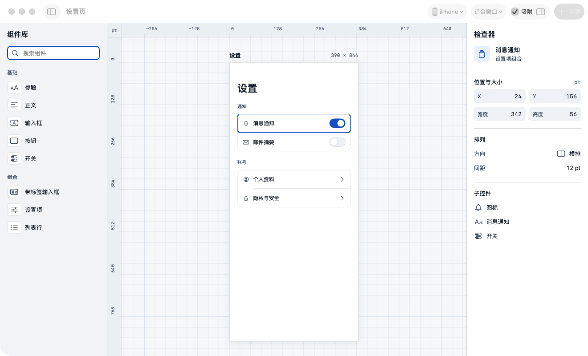
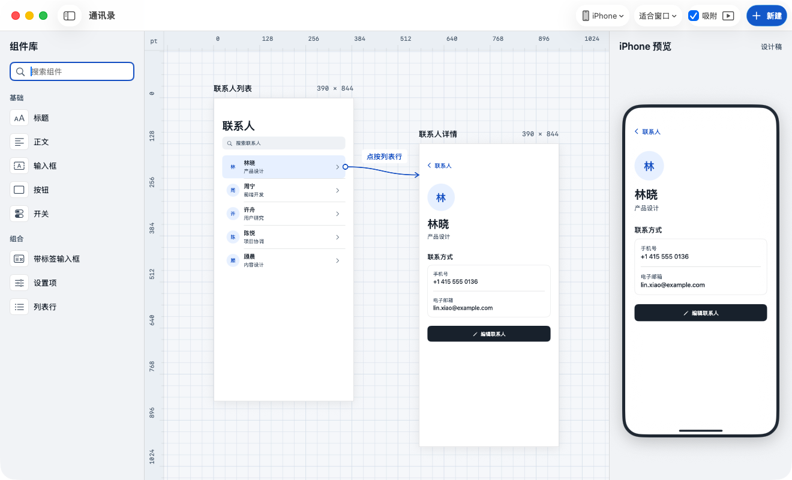

# 阶段 0 · 工作台设计评审

三张图截自 1320 × 800 pt 的原生 macOS 窗口。工具栏最右边是「新建」，同一侧的 iPhone 菜单选择画板尺寸。左侧是组件库，标题栏的侧栏按钮可收起它。

## 空白画板

白色画板在方格中独立成面，只有一处「从左侧拖入组件」提示。空白时收起检查器。组件按基础控件和组合分组，搜索无结果时出现「没有匹配的组件」。

## 选中组合

「消息通知」四角的手柄表示整组已选中。搜索框的圆角边框和插入光标表示键盘焦点。检查器依次显示位置与大小、排列以及三个子控件。数值以画板坐标的 pt 为单位。

## 连线与 iPhone

蓝线从「林晓」所在行指向详情页，起点用圆形端口，末端用箭头，线上方标明触发动作。右侧 iPhone 显示同一条记录。右栏标明「设计稿」，实时模拟器接入属于阶段 2。

## 设计取舍与校验

- 工具层采用系统窗口、工具栏、SF Symbols 和细分隔线。主要操作使用蓝底，吸附使用带勾选标记的系统复选框。检查器也可用菜单命令收放。[Apple HIG · Toolbars](https://developer.apple.com/design/human-interface-guidelines/toolbars) · [Split views](https://developer.apple.com/design/human-interface-guidelines/split-views)
- 用 4 pt 间距组织侧栏，样例控件参照 Astryx Neutral 的 14 pt 正文、10 pt 控件圆角、12 pt 容器圆角。手机样例按画板比例缩放，工具栏和检查器保留桌面字号。按 unslop 检查了间距、颜色、图标、文案、字级、布局、细节、视觉及动效，去掉了重复提示、吸附的大面积亮蓝底和画板内容的叠加阴影。[unslop · Damir Sokolovsky](https://github.com/heydamir/unslop) · [Astryx Neutral 参考值](https://github.com/meta/astryx/blob/be5d290db9f03921256b6b4a2628cfde4f7cb192/packages/native/apple/Sources/Astryx/Theme/Generated/NeutralTheme.swift)
- 以实际 sRGB 色值计算，浅色侧栏的较弱文字为 5.32∶1，标尺为 5.12∶1，蓝底白字为 6.43∶1。深色标尺为 7.39∶1。选区手柄、文本光标和箭头分别提供形状线索。[Apple HIG · Accessibility](https://developer.apple.com/design/human-interface-guidelines/accessibility) · [Focus and selection](https://developer.apple.com/design/human-interface-guidelines/focus-and-selection)

## 验收记录

| 用例 | 结果 | 实际观察 |
| --- | --- | --- |
| 干净检出、构建和启动 | 通过 | 用共享方案构建成功，启动生成的 App 后出现空白画板 |
| 三个状态及新建 | 通过 | 用菜单快捷键进入选中组合和 iPhone 状态，⌘N 返回空白 |
| 键盘焦点和右栏 | 通过 | ⌘F 聚焦搜索，⌥⌘I 能收起并重新打开检查器 |
| 组件搜索反馈 | 通过 | 输入并提交无匹配的查询，就地显示「没有匹配的组件」 |
| 1080 pt 窄窗 | 通过 | 双画板和预览同屏。调整标签位置后，标签和连线各自可见。画板内的示例文字随比例缩小，可收起右栏或放大画布细看 |
| 深色外观 | 通过 | 以深色 macOS 外观打开选中组合，复查了选框、焦点和属性文字 |
| 设计稿确认 | 待用户验收 | 看「新建」、设备菜单和组件库是否容易找到，再区分选区、键盘焦点与连线方向 |

阶段 1 实装后，再从空白用拖放和键盘各插入一次，检查提示消失、落点反馈、就地错误和 ⌘Z 撤销。当前按静态设计稿评审画板内的操作和数值字段。[Apple HIG · Drag and drop](https://developer.apple.com/design/human-interface-guidelines/drag-and-drop) · [Undo and redo](https://developer.apple.com/design/human-interface-guidelines/undo-and-redo)
