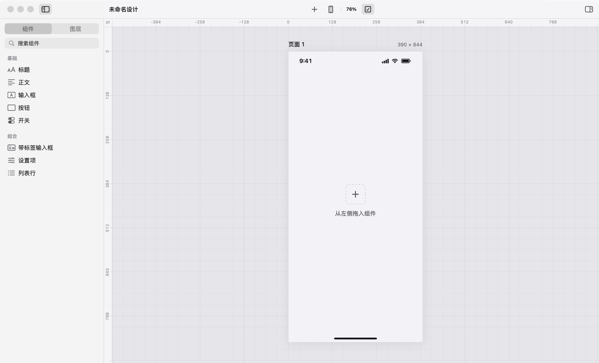

# 阶段 0 · 工作台设计评审

本轮根据附件《gemini-code-1794958381130.md》调整工作台。三个状态仍可用 ⌥⌘1、⌥⌘2、⌥⌘3 切换。此前的工作台截图及评审保存在 Git 提交 `053794e`。

## 空白画板

左栏贴边，从顶部工具栏延伸到底边。组件采用 28 pt 行高和固定的 18 pt 图标列。工具栏加号展开「组件」并聚焦搜索，⌘N 新建空白设计。工具区内的预览、缩放和吸附控件与页面标题同轴。

## 选中组合

「图层」展开后可查看「消息通知」的三个子控件。右栏显示 X、Y、W、H 四项选区读数。原生分段控件和步进器可调整样例的排列方向与间距，画板选框和高度读数随样例更新。iOS 的「通知」和「账号」标题都从白色分组的左边缘内缩 16 pt。

## 连线与 iPhone

两张画板标题同高，曲线从联系人行的 6 pt 圆点引出，在详情画板左缘结束。事件标签居中置于曲线上方。iPhone 预览是可关闭的画布浮窗。空间充足时可与双画板同时查看，空间受限时在画布内居中。当前内容为设计样例，实时模拟器接入安排在阶段 2。

[1080 pt 窄窗](04-compact-flow.png)

## 实现规格

| 部位 | 规格 |
| --- | --- |
| 窗口 | 左栏 228 pt、右栏 272 pt，中间画布自适应；横贯窗口的 40 pt 工具栏，按钮 28 × 24 pt |
| 材质 | AppKit 的侧栏材质加浅灰着色，支持系统减少透明度；检查器浅色底为 `#F5F5F7` |
| 组件与图层 | 顶部原生分段控件、24 pt 搜索框、无外框的 SF Symbols、选中行蓝底白字 |
| 画布 | `#E5E5EA`、双层淡网格、18 pt 标尺和 9 pt 等宽数字的系统字体 |
| 属性 | 22 pt 数值位、0.5 pt 边线、6 pt 网格间距；方向可切换，间距可输入和步进 |
| iOS 样例 | `#F2F2F7` 分组底、状态栏、16 pt 返回箭头、2 pt 三次贝塞尔连线 |

交通灯继续使用 macOS 自带按钮。位置与工具栏中心线对齐，按钮直径及毛玻璃采样由系统绘制。固定尺寸在 SwiftUI 里以点数实施。[Apple HIG · Windows](https://developer.apple.com/design/human-interface-guidelines/windows) · [Materials](https://developer.apple.com/design/human-interface-guidelines/materials) · [Toolbars](https://developer.apple.com/design/human-interface-guidelines/toolbars)

分段控件与步进器使用系统部件。画板与预览浮窗使用轻阴影，三栏由细线界定。搜索焦点用外晕，画板选区用四角手柄。[Apple HIG · Segmented controls](https://developer.apple.com/design/human-interface-guidelines/segmented-controls) · [Steppers](https://developer.apple.com/design/human-interface-guidelines/steppers) · [Focus and selection](https://developer.apple.com/design/human-interface-guidelines/focus-and-selection) · [unslop · Damir Sokolovsky](https://github.com/heydamir/unslop)

## 独立评审与验证

每轮调用 `agy --model gemini-4-carbon-medium --effort medium` 读取相应的窗口渲染。Mac 当时处于锁屏状态，图是用同一套 SwiftUI 和 AppKit 视图离屏渲染的，交通灯显示为系统非活跃态。动态毛玻璃、实屏点击和键盘焦点流转待解锁后验证。
