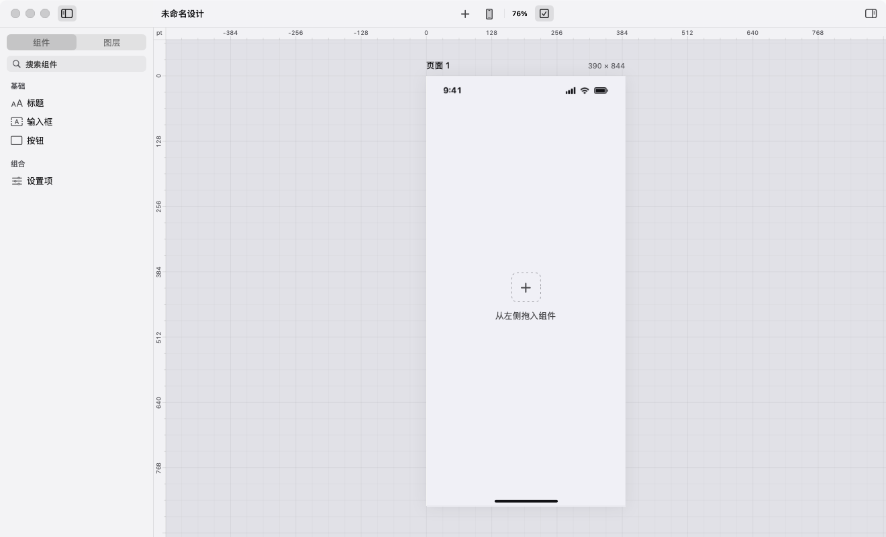
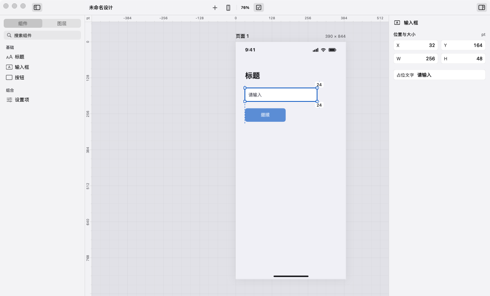
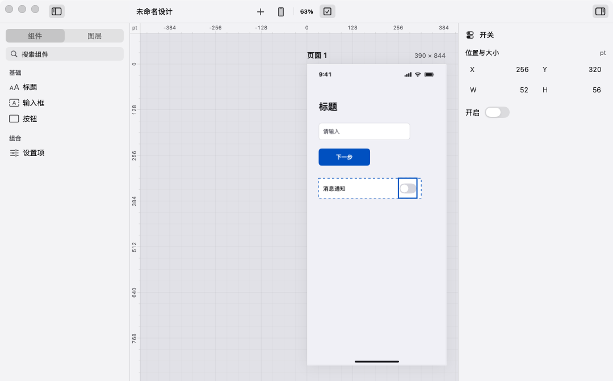
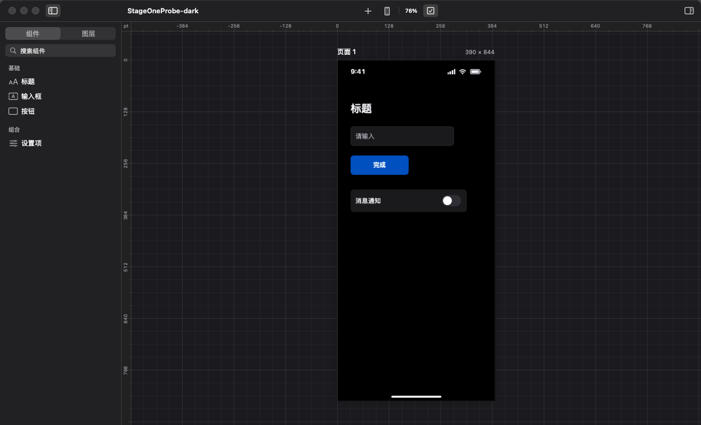

# 阶段 1 · 从空白画板搭出一页

阶段 1 经用户确认通过。实现基于阶段 0 Git 提交 `40453fc`。验证环境为 Apple Silicon、macOS 26.3、Xcode 26.6（17F113）。

## 工作台

- **用途**　从空白画板搭一张界面，随时回到本地设计原稿继续编辑
- **气质**　克制、精确
- **材质**　浅灰侧栏、浅色画板、蓝色选区与工程网格
- **视觉重点**　当前编辑的图层，以及拖动时的半透明预落位
- **识别细节**　等距线直接标出实际间隔，和标尺使用同一坐标

## 本轮核验

| 事项 | 结果 |
| --- | --- |
| 冷启动 | 通过进程内验证。初版先弹出系统「打开」面板，修正后直接创建空白画板，检查器收起 |
| 插入和吸附 | 通过进程内验证。AppKit 拖放接收端依次插入标题、输入框、按钮。按钮对齐到 X=32 pt，上下两个间隔均显示 24，松手后的 Y=236 pt。无效载荷与画板外落点被拒绝 |
| 坐标画布 | 通过进程内验证。缩放后锚点对应同一文档坐标，平移只改变视口。选择「适合窗口」可复位。拖动选框和组内手柄分别更新宽高与间距 |
| 自由移动与撤销 | 通过进程内验证。关闭吸附后，把按钮从 (32, 236) 移到 (39, 267)，撤销后恢复前一位置。组合移动也可独立撤销，子开关编辑保留 |
| 组合与检查器 | 通过进程内验证。设置项由标签和开关两个稳定标识的子控件组成。单击选整组，双击或 ⌘ 单击选内部开关。首次选择展开检查器，手动收起后换选仍保持收起 |
| 键盘与文本 | 通过进程内验证。聚焦组件搜索后用回车插入匹配项，焦点转到画布。回车进入或提交原位文字编辑，Esc 放弃草稿，编辑结束后焦点回到画布 |
| 保存与重开 | 通过进程内验证。原生文档第一次保存到测试目录，之后提交文字修改，文件自动写回。关闭并用原生文档控制器重开，位置、文字、层级和子开关状态相同，项目出现在最近使用列表。另用 Launch Services 从文件启动，只显示该项目窗口，原有四个图层完整 |
| 视觉与尺寸 | 核对 1320 × 800 pt 浅色、1080 × 672 pt 窄窗与深色画面。第一次选中后抵消检查器造成的画板偏移。小字号栏内文字和白字选中色使用更深的颜色 |
| 自动测试 | 7 项测试覆盖版本与坏文件、文件回读、吸附与等距、关闭吸附、单步撤销和重做、检查器收起偏好、定位换算与数值输入 |

Mac 锁屏期间，通过 SwiftUI 和 AppKit 的实际窗口进行离屏渲染。拖放短片来自程序向 AppKit 拖放接收端发送移动并逐帧捕获的画面。[拖放短片](拖放与吸附.mp4) · [试用样例](阶段一试用样例.uidesign)

2026 年 11 月 17 日，用户确认阶段 1 通过。下方保留试用步骤，供后续回归检查。

## 亲手试用

1. 在 Xcode 按 ⌘R。由空白画板拖入三个组件，双击按钮把文字改成「完成」。
2. 移动第三个控件，观察辅助线和间距数值。轮流开关吸附，检查松手前后位置。用空格拖动画布，试一次缩放，再选「适合窗口」。
3. 插入设置项，移动整组，再双击或 ⌘ 单击开关。切换开关，收起检查器后改选另一图层。撤销一次移动。
4. 从 ⌘F 开始，全程用键盘插入组件，编辑文字并退出。检查焦点和撤销。
5. 按 ⌘S 自选文件夹，改一处文字后关闭，再从 Finder 或「打开最近使用」重开。核对三个组件和设置组。记录第一次卡住的位置，修正后使用同一流程复测。

## 设计依据

拖放有位置反馈、无效落点处理与键盘替代操作。选组、进组和原位文字编辑用原生焦点与标准撤销。字号在编辑器面板上保持固定，作品内容随画布比例缩放。[Apple HIG · Drag and drop](https://developer.apple.com/design/human-interface-guidelines/drag-and-drop) · [Focus and selection](https://developer.apple.com/design/human-interface-guidelines/focus-and-selection) · [Undo and redo](https://developer.apple.com/design/human-interface-guidelines/undo-and-redo) · [Typography](https://developer.apple.com/design/human-interface-guidelines/typography) · [unslop · Damir Sokolovsky](https://github.com/heydamir/unslop)

项目文件通过 SwiftUI 文档组注册本地类型，编辑使用原生撤销管理器，一次完成的手势对应一次可撤销操作。[Apple · DocumentGroup](https://developer.apple.com/documentation/swiftui/documentgroup) · [UndoManager](https://developer.apple.com/documentation/foundation/undomanager)
