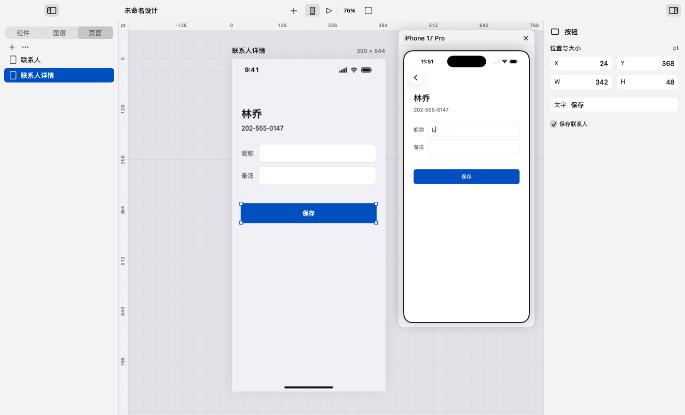
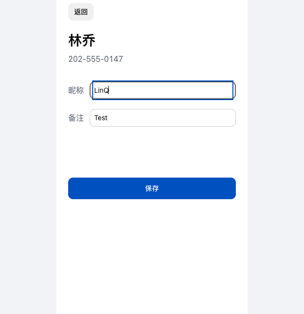

# 阶段 2 · 联系人列表与详情

阶段 2 在阶段 1 提交 `4a76f6d` 上开发。下表记录程序复测，整轮用户试用待进行。[联系人示例](联系人示例.uidesign) · [运行说明](../../README.md#运行联系人示例)

测试环境为 Apple Silicon、macOS 26.3、Xcode 26.6（17F113）、iPhone 17 Pro 模拟器（iOS 26.5，23F77）和系统默认浏览器 Ego Lite（Chromium 156）。用专用模拟器测试画面及输入，Web 使用编辑器发布的回环地址。联系人均为示例数据。

## 验收用例

| 用例 | 实际结果 |
| --- | --- |
| 从联系人画板运行 | 通过。Mac 工作台显示模拟器回传的真实画面。工作台接收点按和滑动，再发送给专用模拟器。两端打开林乔和陈亦舟，分别显示 202-555-0147 与 202-555-0162，返回后可继续选人。模拟器内滑动后，第四行向上移动约 60 pt。 |
| 移动保存按钮 | 通过。提交位置变化后，两端继续显示林乔，保留昵称 `Lin` 和备注 `Test`。继续输入后，昵称为 `LinQ`。另一次经 AppKit 实际拖动 32 pt，画板在松手时提交，模拟器更新后保留 `Li`。[拖动与刷新短片](拖动画板与模拟器刷新.mp4) |
| 删除字段与当前页 | 通过。删除备注后，林乔和昵称 `LinQ` 保留。删除联系人详情后，两端回到有效的联系人列表。 |
| 独立构建和运行导出 | 通过。使用 Xcode 构建 SwiftUI 源码，用锁定依赖构建 React/Astryx 源码。关闭验收用编辑器后分别启动两端，打开林乔，核对姓名、电话和导航。两端保存回调都收到 `{"contactID":"lin","values":{"nickname":"LinQ","note":"Test"}}`。 |
| 文件与编辑回归 | 通过。11 项测试覆盖阶段 1 的拖放坐标、选区、撤销、文件读写与阶段 2 的版本迁移、删除页面及目标连线的整批撤销、同地址发布和导出目录保护。 |

编辑器的程序复测通过实际 AppKit 输入面发送模拟器动作，并使用模拟器无障碍树核对结果。Web 使用浏览器点按、填表、键盘焦点及 DOM 几何核对。独立工程的控件和动作入口分别在 `GeneratedPages.swift`、`GeneratedPages.jsx`，宿主接入点分别在 `ContactActions.swift`、`contactActions.js`。

## 耗时

每次将保存按钮下移 8 pt。开始提交后，iPhone 测到无障碍树中的新坐标和原草稿，Web 测到新坐标、原草稿和仍聚焦的昵称输入框。计时含自动化采样开销。

| 端 | 第 1 次 | 第 2 次 | 第 3 次 | 第 4 次 | 第 5 次 |
| --- | ---: | ---: | ---: | ---: | ---: |
| iPhone | 1,889 ms | 256 ms | 266 ms | 290 ms | 261 ms |
| Web | 212 ms | 208 ms | 109 ms | 208 ms | 208 ms |

- 新建专用模拟器，首次启动至系统就绪为 37.2 秒。模拟器已启动时，两次从工作台发起到收到首帧分别约 1.36 秒和 25.83 秒。后一次与其他构建和测试并行。调整 SwiftUI 模板后触发重编的一次约 102.22 秒。
- 已构建的 Web 预览打开地址至联系人列表可见，两次分别为 214 ms 和 2,497 ms。独立构建产物从打开地址至列表可见为 240 ms。首次依赖下载耗时随网络变化。
- 模拟器初次探测约每 0.16 秒拿到一帧。面板使用 AXe 帧流，滑动由鼠标松开或滚动结束时提交，输入和逐帧显示速度需要实屏试用判断。

## 界面复查

- 工作台使用已有的蓝白配色、浅灰侧栏和坐标方格。蓝色落在当前页面和保存动作上。菜单提供运行、导出，模拟器面板可收起。
- 详情保留姓名、电话号码、两个字段标签和一个保存按钮。标签在输入后仍可见。本轮把原生详情的辅助文字加深，把 Web 保存按钮调整为同一蓝色并保证 44 CSS px 高度。
- 390 CSS px 宽的 Web 详情未出现横向滚动，使用 Shift+Tab 从保存返回备注输入框。Mac 选择和键盘焦点的实屏连贯性、不同窗口尺寸下的拖动手感及中文输入法留待用户试用。[Apple HIG · Accessibility](https://developer.apple.com/design/human-interface-guidelines/accessibility) · [Layout](https://developer.apple.com/design/human-interface-guidelines/layout) · [Focus and selection](https://developer.apple.com/design/human-interface-guidelines/focus-and-selection) · [unslop · Damir Sokolovsky](https://github.com/heydamir/unslop)

